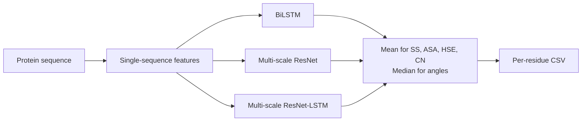

# SPOT-1D-Single

**Predict protein secondary structure, solvent accessibility, half-sphere exposure, contact number and backbone angles from a single sequence, without alignments.**

[](https://doi.org/10.1093/bioinformatics/btab316)
[](https://huggingface.co/Jas-preet/SPOT-1D-Single)
[](https://huggingface.co/datasets/Jas-preet/SPOT-datasets)
[](https://github.com/jas-preet/SPOT-1D-Single/actions/workflows/tests.yml)
[](LICENSE)

Most accurate structure predictors need an evolutionary profile built from a multiple sequence alignment. That is slow to compute, and many proteins have few or no homologs to align. SPOT-1D-Single uses the sequence alone. It is an ensemble of deep networks trained on 39,120 proteins, a much larger set than earlier single-sequence methods used, and a typical protein takes a few seconds on a laptop CPU.


## Contents

- [Highlights](#highlights)
- [Quick start](#quick-start)
- [What it predicts](#what-it-predicts)
- [Method](#method)
- [Results from the paper](#results-from-the-paper)
- [Installation](#installation)
- [Usage](#usage)
- [Output](#output)
- [Working with the output](#working-with-the-output)
- [Limitations](#limitations)
- [Datasets](#datasets)
- [Related tools](#related-tools)
- [Tests](#tests)
- [Citation](#citation)
- [License](#license)

## Highlights

- **No alignment needed.** Predictions come from the sequence alone, so they work the same way for proteins with no known homologs.
- **Better than earlier single-sequence methods.** In the paper, 3-state secondary structure accuracy is 72.1–74.3% across seven independent test sets, compared with 69.1–72.6% for SPIDER3-Single and 70.6–73% for ProteinUnet.
- **Strong on proteins with no homologs.** On SPOT-2018 proteins with no homologs (Neff = 1), it is 6.24% (SS3) and 6.98% (SS8) more accurate than the profile-based SPOT-1D.
- **Light.** It needs under 1 GB of RAM. In the paper it handled 250 proteins in 155 s on a 16-thread CPU.

## Quick start

```bash
git clone https://github.com/jas-preet/SPOT-1D-Single.git
cd SPOT-1D-Single
pip install -r requirements.txt

curl -LO https://huggingface.co/Jas-preet/SPOT-1D-Single/resolve/main/jits.tar.xz
echo "8fef1e8091866f43f56f6c9e02f719607e0825a64c37d7fe8df7c2e3a07d1ea0  jits.tar.xz" | shasum -a 256 -c
tar -xf jits.tar.xz

python spot1d_single.py --file_list file_lists/file_list_casp13.txt --save_path results/
```

On Linux, use `sha256sum -c` instead of `shasum -a 256 -c`.

## What it predicts

For every residue:

| Property | Output | Notes |
| --- | --- | --- |
| Secondary structure, 3-state | `SS3`, `P3C` `P3E` `P3H` | Coil, strand, helix (DSSP) |
| Secondary structure, 8-state | `SS8`, `P8C` … `P8B` | DSSP classes C, S, T, H, G, I, E, B |
| Solvent accessibility | `ASA` | Accessible surface area in Ų |
| Half-sphere exposure | `HseU`, `HseD` | Up and down half-spheres |
| Contact number | `CN` | |
| Backbone torsion angles | `Phi`, `Psi` | Degrees |
| Cα angles | `Theta`, `Tau` | Cα bond angle θ and dihedral τ, in degrees |

## Method

SPOT-1D-Single is an ensemble of three networks, each trained once for classification (secondary structure) and once for regression (everything else):

| Model | Architecture |
| --- | --- |
| 1 | 2-layer bidirectional LSTM followed by two fully connected layers |
| 2 | Multi-scale 1D ResNet with three parallel stacks of 15 blocks (kernel sizes 3, 5 and 7) |
| 3 | Multi-scale ResNet combined with 4 bidirectional LSTM layers |

The ensemble averages the secondary structure probabilities, ASA, HSE and contact number, and takes the median of the angles. Each angle is predicted as a sine and cosine pair.



**Training data:** ProteinNet, with PDB chains deposited before 2016, resolution below 2.5 Å and clustered at 95% sequence identity. That gives 39,120 proteins for training and 100 for validation, after removing training proteins similar to the validation set (HHsearch e-value < 0.1).

## Results from the paper

All numbers are copied from [Singh et al., 2021](https://doi.org/10.1093/bioinformatics/btab316). Test sets contain no proteins similar to the training set.

**Secondary structure accuracy (%), SS3 / SS8** (Table 3)

| Method | TEST2018 | SPOT-2018 | CASP12-FM | CASP13-FM |
| --- | --- | --- | --- | --- |
| **SPOT-1D-Single** | **74.28 / 62.17** | **73.71 / 60.09** | **72.44 / 57.59** | **73.21 / 60.93** |
| SPIDER3-Single | 72.57 / 59.81 | 71.29 / 57.38 | 69.15 / 55.15 | 71.26 / 57.00 |
| ProteinUnet | 72.57 / 60.30 | — | 71.33 / 57.56 | 70.63 / 58.07 |
| PSIPRED-Single (SS3 only) | 68.91 | 68.00 | 68.13 | 68.05 |
| *SPOT-1D (profile-based)* | *86.18 / 75.41* | *80.39 / 67.43* | *79.53 / 65.92* | *83.55 / 71.22* |

**Pearson correlation on TEST2018** (Table 5)

| Method | ASA | HSE-up | HSE-down | CN |
| --- | --- | --- | --- | --- |
| **SPOT-1D-Single** | **0.665** | **0.573** | **0.563** | **0.585** |
| SPIDER3-Single | 0.647 | 0.523 | 0.487 | 0.547 |
| ProteinUnet | 0.620 | 0.537 | 0.510 | 0.545 |

**Mean absolute error of angles on TEST2018, degrees** (Table 6)

| Method | ψ | ϕ | θ | τ |
| --- | --- | --- | --- | --- |
| **SPOT-1D-Single** | **40.58** | **22.16** | **9.35** | **42.32** |
| SPIDER3-Single | 43.05 | 23.78 | 11.08 | 45.38 |
| ProteinUnet | 42.93 | 23.42 | 10.28 | 44.94 |

**Proteins with no homologs (SPOT-2018, Neff = 1)** (Table 4)

| Method | SS3 | SS8 | ASA | CN |
| --- | --- | --- | --- | --- |
| **SPOT-1D-Single** | **76.57** | **65.24** | **0.641** | **0.547** |
| SPOT-1D (profile-based) | 72.07 | 60.98 | 0.616 | 0.535 |

**Ensembling helps.** On TEST2018 the individual models reach 73.00–73.47% SS3, and the ensemble reaches 74.28% (Table 2).

**Speed on 250 TEST2018 proteins** (Table 7)

| Hardware | SPIDER3-Single | ProteinUnet | SPOT-1D-Single |
| --- | --- | --- | --- |
| 16 CPU threads (Xeon E5-2620 v4) | 311 s | 109 s | 155 s |
| GTX 1080 Ti GPU | — | 121 s | 56 s |

## Installation

### Requirements

- About 1 GB of free RAM on CPU (measured peak: 0.8 GB for a 353-residue protein, 0.7 GB for 3,000 residues)
- Python 3 with PyTorch, NumPy and pandas
- Optional: an NVIDIA GPU with CUDA

Tested on CPU with Python 3.12 and 3.13, PyTorch 2.13 and 2.15, NumPy 2.5 and pandas 3. The checkpoints were exported with PyTorch 1.6 on Python 3.7, and `requirements.txt` does not pin versions. If your PyTorch cannot load the checkpoints, use the [original environment](#original-environment).

### Code

```bash
git clone https://github.com/jas-preet/SPOT-1D-Single.git
cd SPOT-1D-Single
pip install -r requirements.txt
```

### Checkpoints

Download the checkpoints (1.2 GB) from [Hugging Face](https://huggingface.co/Jas-preet/SPOT-1D-Single) and check the download:

```bash
curl -LO https://huggingface.co/Jas-preet/SPOT-1D-Single/resolve/main/jits.tar.xz
echo "8fef1e8091866f43f56f6c9e02f719607e0825a64c37d7fe8df7c2e3a07d1ea0  jits.tar.xz" | shasum -a 256 -c
tar -xf jits.tar.xz
```

If Hugging Face is unavailable, the same file is on the lab server (plain HTTP only, so keep the checksum check):

```bash
curl -LO http://183.36.5.251:8080/sparks_downloads/servers/downloads/Resource/Protein/2_Protein_local_structure_prediction/jits.tar.xz
```

It is also listed on the [Zhou lab download page](https://zhouyq-lab.szbl.ac.cn/download/).

### Original environment

```bash
conda create -n spot_single_env python=3.7
conda activate spot_single_env
conda install pytorch==1.6.0 torchvision==0.7.0 cpuonly -c pytorch   # GPU: replace cpuonly with cudatoolkit=10.1
conda install pandas=1.1.1
```

## Usage

Make a text file listing one FASTA file per line, then run:

```bash
python spot1d_single.py --file_list file_lists/file_list_casp13.txt --save_path results/ --device cpu
```

| Option | Description |
| --- | --- |
| `--file_list` | Required. Text file with one FASTA path per line. Relative paths are resolved from the current directory. |
| `--save_path` | Output directory, created if needed. Default: `results/` |
| `--device` | `cpu` (default) or `cuda:0` |
| `--jits_dir` | Directory holding the checkpoints. Default: `jits/` next to the script |

Each FASTA file must contain one sequence. Lower-case letters are accepted, a trailing `*` is removed, and residues other than the 20 standard amino acids are treated as unknown. Unknown residues have no reference surface area, so their `ASA` value (between 0 and 1) is a placeholder and does not mean the residue is buried.

## Output

Each input produces `<save_path>/<fasta file name>.csv`, with one row per residue. These are the first rows for CASP13 target T0950-D1:

```text
,AA,SS3,SS8,ASA,HseU,HseD,CN,Psi,Phi,Theta,Tau,...
0,M,C,C,180.41475,2.908227,7.6363535,11.474195,143.97278,-85.62398,113.363304,178.49866,...
1,S,C,C,96.02234,4.113958,7.619543,13.264882,149.1548,-90.90395,117.24941,-172.61833,...
2,E,C,C,142.44878,3.8241239,11.088156,16.01151,144.72142,-101.91957,119.126144,-158.61365,...
```

| Column | Meaning |
| --- | --- |
| `AA` | Amino acid |
| `SS3`, `SS8` | Predicted 3-state and 8-state secondary structure |
| `ASA` | Accessible surface area (Ų) |
| `HseU`, `HseD` | Half-sphere exposure, up and down |
| `CN` | Contact number |
| `Psi`, `Phi`, `Theta`, `Tau` | Backbone angles in degrees |
| `P3C`, `P3E`, `P3H` | 3-state probabilities |
| `P8C`, `P8S`, `P8T`, `P8H`, `P8G`, `P8I`, `P8E`, `P8B` | 8-state probabilities |

## Working with the output

Load a prediction with pandas:

```python
import pandas as pd

df = pd.read_csv("results/T0950-D1.csv", index_col=0)

print("".join(df.SS3)[:60])                          # secondary structure string
print(df.SS3.value_counts(normalize=True).round(2))  # fraction helix / coil / strand
print(df[["AA", "SS3", "P3H", "ASA", "Phi", "Psi"]].head(3))
```

```text
CCCCCCCCCCCCCCCCCCHHHHHHHHHHHHHHHHCCCCCEEEECCCEEEEEEECCCHHHH
SS3
H    0.76
C    0.19
E    0.05
  AA SS3       P3H        ASA        Phi        Psi
0  M   C  0.000008  180.41475  -85.62398  143.97278
1  S   C  0.012949   96.02234  -90.90395  149.15480
2  E   C  0.025156  142.44878 -101.91957  144.72142
```

Some common uses:

- **Relative accessibility:** divide `ASA` by the residue's maximum ASA (`MAX_ASA` in `dataset/data_functions.py`) to get a 0–1 value. Residues below about 0.25 are often treated as buried.
- **Confidence:** the largest of `P3C`, `P3E` and `P3H` is the model's confidence in the `SS3` call.
- **Inputs for other tools:** [SPOT-Contact-LM](https://github.com/jas-preet/SPOT-Contact-LM) reads these CSV files directly.

## Limitations

- Accuracy is still well below profile-based methods for proteins that have many homologs (see SPOT-1D in the tables above). For those, use a profile-based method or [SPOT-1D-LM](https://github.com/jas-preet/SPOT-1D-LM).
- Proteins are processed one at a time, because the checkpoints do not support batches larger than 1 ([#1](https://github.com/jas-preet/SPOT-1D-Single/issues/1)).
- The GPU checkpoints only run on `cuda:0`, because of how they were exported with `torch.jit.trace`.
- The training code is not included.

## Datasets

The splits used in the paper, with per-residue labels for every protein that has them, are on Hugging Face as [Jas-preet/SPOT-datasets](https://huggingface.co/datasets/Jas-preet/SPOT-datasets) (configuration `spot-1d-single`):

```python
from datasets import load_dataset

ds = load_dataset("Jas-preet/SPOT-datasets", "spot-1d-single", revision="v1.0")
print(ds)
```

Labels are available for all of TEST2018 and the CASP sets, 38,913 of the 39,120 training chains, and part of the SPOT-2016 and SPOT-2018 sets; the [dataset card](https://huggingface.co/datasets/Jas-preet/SPOT-datasets#spot-1d-single) has the full coverage table. The original ID lists are also available on their own:

```bash
curl -L -o datasets.tar.xz "https://www.dropbox.com/scl/fi/ek78e18wq80jvet0ewf9a/datasets.tar.xz?rlkey=u04bs6ocqieoswrryotdt3d1r&dl=1"
```

| Set | Proteins | Description |
| --- | --- | --- |
| Training | 39,120 | ProteinNet, PDB before 2016 |
| Validation | 100 | Held out from ProteinNet |
| TEST2018 | 250 | Released January–June 2018, < 25% identity to earlier PDB entries |
| SPOT-2016 / SPOT-2016-HQ | 1,473 / 295 | Released 2016–2020, no detectable homology to training data |
| SPOT-2018 / SPOT-2018-HQ | 682 / 125 | Released 2018–2020, no detectable homology to training data |
| CASP12-FM / CASP13-FM | 22 / 17 | Free-modelling targets |

The `-HQ` sets keep only structures with resolution below 2.5 Å and R-free below 0.25.

## Related tools

| Tool | Input | Predicts | Use it when |
| --- | --- | --- | --- |
| **SPOT-1D-Single** (this repo) | Sequence | 1D structural properties | You need fast, light predictions |
| [SPOT-1D-LM](https://github.com/jas-preet/SPOT-1D-LM) | Sequence plus ESM-1b and ProtT5 embeddings | The same properties, more accurately | You can spare about 16 GB of RAM and 30 GB of disk |
| [SPOT-Contact-LM](https://github.com/jas-preet/SPOT-Contact-LM) | Sequence, ESM-1b and SPOT-1D-Single output | Residue contact map | You need contacts for structure modelling |

## Tests

The tests use small stand-in models, so they don't need the checkpoints.

```bash
pip install pytest
pytest
```

## Citation

If you use SPOT-1D-Single, please cite:

Singh J, Litfin T, Paliwal K, Singh J, Hanumanthappa AK, Zhou Y. SPOT-1D-Single: improving the single-sequence-based prediction of protein secondary structure, backbone angles, solvent accessibility and half-sphere exposures using a large training set and ensembled deep learning. *Bioinformatics*. 2021;37(20):3464-3472. [doi:10.1093/bioinformatics/btab316](https://doi.org/10.1093/bioinformatics/btab316)

```bibtex
@article{singh2021spot1dsingle,
  title   = {{SPOT-1D-Single}: improving the single-sequence-based prediction of protein secondary structure, backbone angles, solvent accessibility and half-sphere exposures using a large training set and ensembled deep learning},
  author  = {Singh, Jaspreet and Litfin, Thomas and Paliwal, Kuldip and Singh, Jaswinder and Hanumanthappa, Anil Kumar and Zhou, Yaoqi},
  journal = {Bioinformatics},
  volume  = {37},
  number  = {20},
  pages   = {3464--3472},
  year    = {2021},
  doi     = {10.1093/bioinformatics/btab316}
}
```

## License

[MIT](LICENSE)
